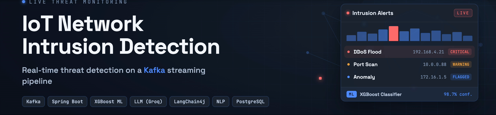
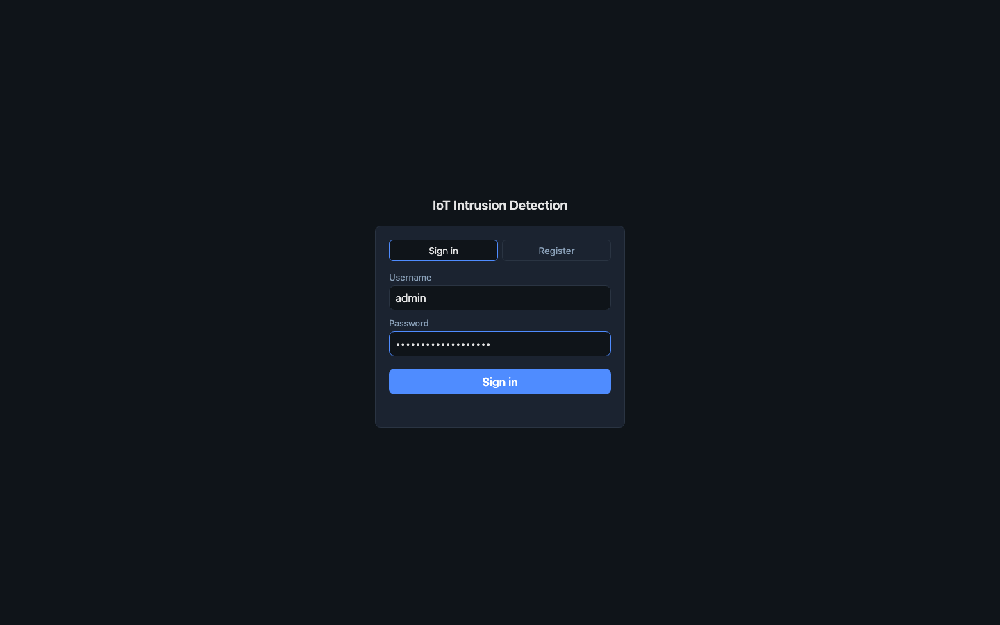
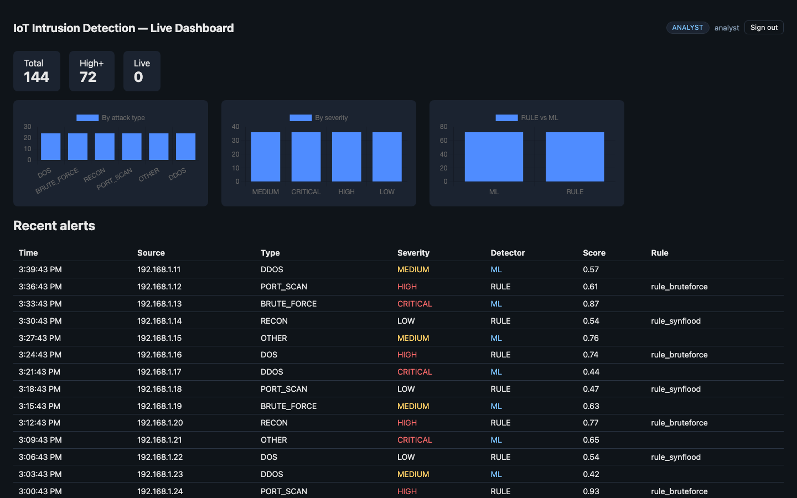
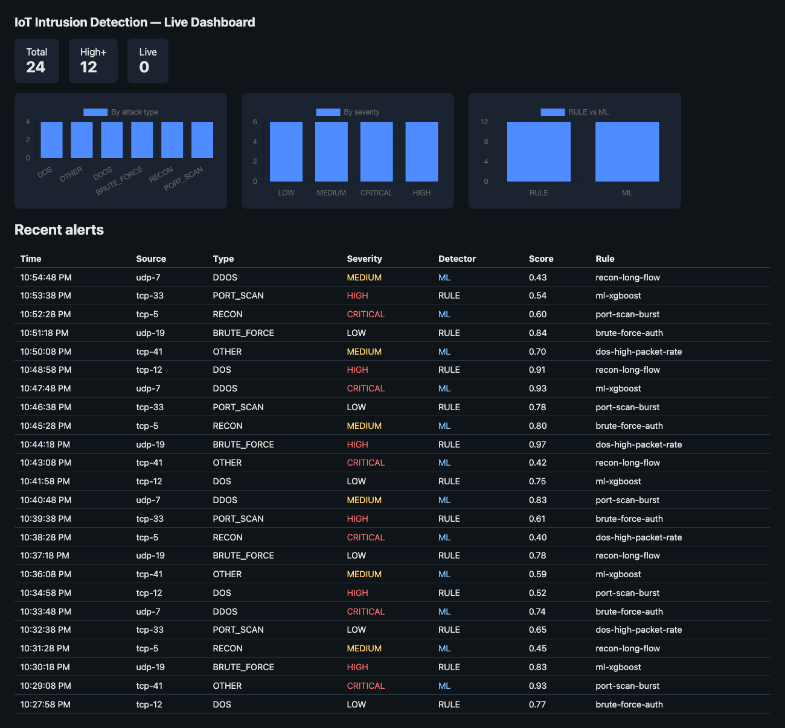
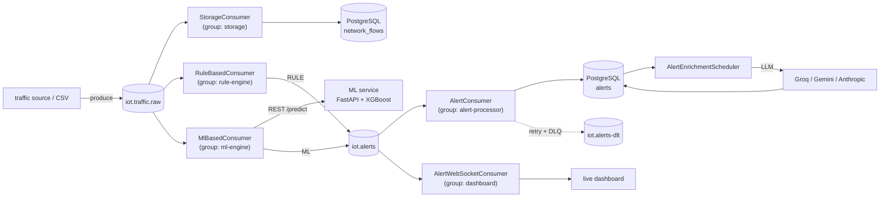
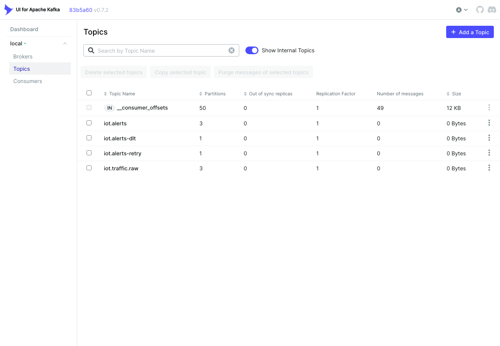
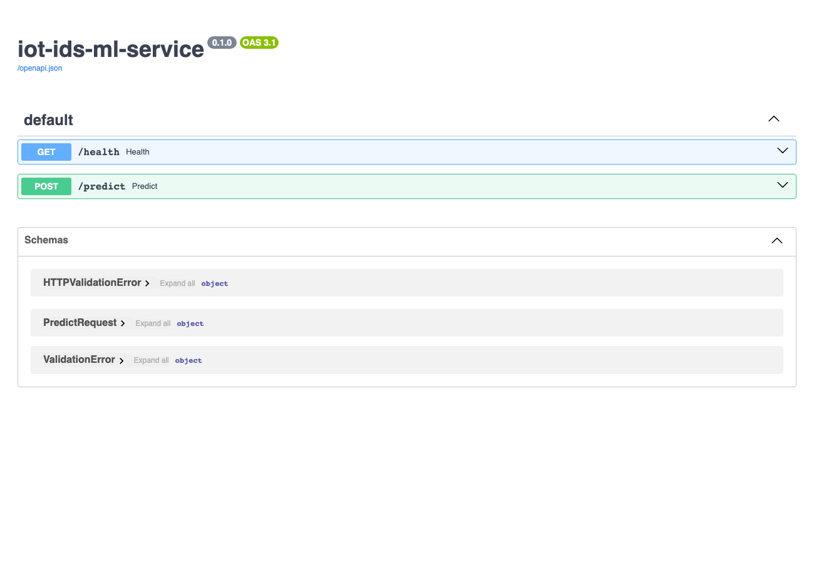
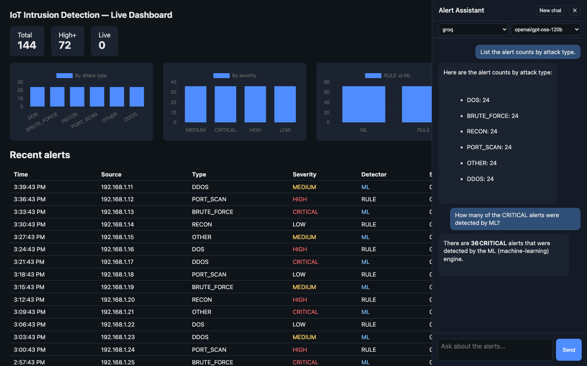

<p align="center">
  
</p>

# IoT Network Intrusion Detection

A Kafka-based streaming system that performs near real-time intrusion detection on
RT-IoT2022 network traffic. Built with Spring Boot producers/consumers, PostgreSQL,
rule-based and ML-based anomaly detection, a REST API with a live dashboard, and an
LLM layer (alert enrichment + natural-language chat) that runs on a free provider.

## Demo

### Sign in



JWT-backed sign-in and registration. Accounts live in PostgreSQL with BCrypt hashes; a
successful sign-in returns a short-lived HS256 token that the dashboard sends on every REST
call and on the STOMP `CONNECT` frame.



Above: an `ANALYST` session. The role badge and **Sign out** sit in the header, and the
`Ask 🤖` chat button is absent — the LLM endpoints are `ADMIN`-only.

### Live dashboard



Real-time alert table (fed over WebSocket) with severity, detector (RULE / ML) and score,
plus live charts by attack type, severity, and detection source.

### Streaming architecture



Each detector is its own Kafka consumer group, so storage, rule-based and ML detection
independently receive every traffic message; alert delivery uses a retry topic and a
dead-letter topic.



### ML detection service

A FastAPI + XGBoost microservice classifies each flow.



```bash
curl -s -X POST localhost:8000/predict -H "Content-Type: application/json" \
  -d '{"features": {"fwd_pkts_tot": 1500, "flow_duration": 2.3}}'
# {"attack_type": "PORT_SCAN", "score": 0.826}
```

### LLM enrichment & natural-language chat (free — runs on Groq by default)

A scheduled poller enriches each alert with a plain-language explanation and recommendation:

```json
{
  "attackType": "DDOS", "severity": "MEDIUM", "detectionSource": "ML",
  "llmExplanation": "A medium-severity DDoS attack is detected, targeting DNS services over UDP, indicating potential reconnaissance activity.",
  "llmRecommendation": "Verify DNS server logs and implement rate limiting on UDP traffic to prevent abuse."
}
```

Ask questions in plain language — the assistant tool-calls the alert queries to answer:

```bash
# /api/chat is ADMIN-only, so sign in first and send the token.
TOKEN=$(curl -s -X POST localhost:8080/api/auth/login -H "Content-Type: application/json" \
  -d '{"username": "admin", "password": "'"$SEED_ADMIN_PASSWORD"'"}' \
  | python3 -c 'import json,sys; print(json.load(sys.stdin)["token"])')

curl -s -X POST localhost:8080/api/chat -H "Content-Type: application/json" \
  -H "Authorization: Bearer $TOKEN" \
  -d '{"question": "Give me an overall threat summary."}'
# {"answer": "There have been a total of 24 alerts detected, with 12 from rule-based detection
#   and 12 from machine learning-based detection ... 4 alerts of each type ... 6 of each severity."}
```

The provider is configurable (`app.llm.provider = groq | gemini | anthropic`); Groq's free
tier needs no credit card. See [Configuration](#configuration).

The dashboard also ships an in-page **chat drawer** for the same assistant, so you can ask
without leaving the alerts view. It is **multi-turn** (the assistant remembers earlier turns in
the session), renders answers as **sanitized markdown**, offers clickable **starter prompts**,
and persists the conversation across page reloads.

A **provider/model selector** in the drawer header lets you switch the LLM at runtime. Only
providers whose API key is present in the environment are offered, each with a curated model
list (for the free Groq tier: `llama-3.3-70b-versatile` and `openai/gpt-oss-120b`). Because
conversation memory is keyed by session and shared across models, you can **switch model
mid-conversation** and the new model still sees the earlier turns.



Above: after listing alert counts by attack type on one model, the user switches the model
dropdown to `gpt-oss-120b` and asks a combined question — *"how many of the CRITICAL alerts
were detected by ML?"* — which the assistant answers by cross-filtering severity and detection
source.

## Architecture (Phase 1 — ingest & store)

```
CSV  ->  Kafka (iot.traffic.raw)  ->  StorageConsumer  ->  PostgreSQL
```

A `CsvReplaySimulator` reads the RT-IoT2022 CSV schema-agnostically and publishes each
flow as a `TrafficEvent` to the `iot.traffic.raw` topic (keyed by source). `StorageConsumer`
consumes the topic and persists each flow into the `network_flows` table.

## Phase 2 — Rule-based detection

```
                         ┌─ StorageConsumer (group: storage)        -> network_flows
iot.traffic.raw  ────────┤
                         └─ RuleBasedConsumer (group: rule-engine)  -> iot.alerts
                                                                          │
                                              AlertConsumer (group: alert-processor) -> alerts
                                              (retry + dead-letter: iot.alerts-dlt)
```

Rules are config-driven thresholds defined under `app.rules` in `application.yml`, so new
detections are added without code changes. Because `rule-engine` is a separate consumer
group from `storage`, both consumers independently receive every traffic message.

## Phase 3 — ML-based detection

```
                ┌─ StorageConsumer    (group: storage)     -> network_flows
iot.traffic.raw ┼─ RuleBasedConsumer  (group: rule-engine) -> iot.alerts (RULE)
                └─ MlBasedConsumer    (group: ml-engine)   -> ml-service /predict
                                                                 │  attack_type != NORMAL
                                                                 ▼
                                                             iot.alerts (ML)
```

A Python FastAPI service (`ml-service/`) serves an XGBoost classifier trained offline
(`train.py`, on RT-IoT2022 if present, otherwise on synthetic labeled data). `MlBasedConsumer`
reads `iot.traffic.raw` under its own consumer group, calls the model over REST with a timeout,
and publishes `detectionSource=ML` alerts. If the ML service is unavailable the call falls back
silently — storage and rule-based detection are unaffected. ML can be toggled with `app.ml.enabled`.

Run the ML service with `docker compose up -d --build ml-service` (or locally: `cd ml-service &&
pip install -r requirements.txt && python train.py && uvicorn app:app --port 8000`).

## Phase 4 — REST API, WebSocket & dashboard

```
iot.alerts ─┬─ AlertConsumer        (group: alert-processor) -> alerts table
            └─ AlertWebSocketConsumer (group: dashboard)     -> STOMP /topic/alerts -> browser
```

A read-only REST API exposes recent alerts (`GET /api/alerts`, optional `?severity=`) and
aggregate stats (`GET /api/stats`). A new `dashboard` consumer group relays each alert over
STOMP/WebSocket (`/ws` → `/topic/alerts`). The static dashboard (`src/main/resources/static/`,
Chart.js) shows a live alerts table fed by WebSocket plus charts refreshed from `/api/stats`.

Run the app (`./mvnw spring-boot:run`) and open `http://localhost:8080/`. Publish traffic to
`iot.traffic.raw` (see Phase 1) to see rule-based and ML alerts appear live.

## Phase 5 — LLM enrichment and natural-language chat

```
alerts table  -->  AlertEnrichmentScheduler  -->  SecurityAnalystService  -->  alerts.llm_explanation / llm_recommendation
```

**Scheduled enrichment poller:** A background scheduler polls for alerts that have no LLM
explanation yet (ordered by creation time, configurable batch size) and calls
`SecurityAnalystService` for each one. The service sends alert metadata to an LLM and writes
the returned `explanation` and `recommendation` back to the `alerts` table via
`applyLlmEnrichment`. Per-alert errors are caught and logged so a single failure does not
stop the batch.

**Natural-language chat (`POST /api/chat`):** `NlQueryService` wires an LLM assistant with
tool-calling over the existing REST query layer (`AlertQueryTools`). The assistant can answer
questions such as "how many HIGH alerts in the last hour?" by invoking the right query tool and
returning a plain-language answer. When LLM is disabled the endpoint returns `503 Service
Unavailable`.

**Runtime model selection:** `GET /api/llm/options` reports the providers that have an API key
present and their curated model lists; `POST /api/chat` accepts an optional `provider`/`model`
and echoes the pair that actually answered. A registry caches one assistant per
`(provider, model)`, all sharing a single session-keyed chat-memory store, so switching model
mid-conversation preserves history. Enrichment always uses the configured default provider/model.

**Configuration (`application.yml`):**

| Key | Purpose |
|-----|---------|
| `app.llm.enabled` | Enable/disable all LLM features (default `false`) |
| `app.llm.provider` | Default LLM provider: `groq` (default), `gemini`, or `anthropic` |
| `app.llm.groq.model` | Default Groq model id |
| `app.llm.groq.models` | Groq models offered in the chat selector |
| `app.llm.gemini.model` / `.models` | Gemini default model + selectable list |
| `app.llm.anthropic.model` / `.models` | Anthropic default model + selectable list |
| `app.llm.timeout` | Per-call timeout |
| `app.llm.enrichment.batch-size` | Alerts processed per scheduler tick |
| `app.llm.enrichment.poll-interval` | Scheduler polling interval |

**Runtime requirement:** set the matching API key for your chosen `app.llm.provider`
(`GEMINI_API_KEY` for Gemini, `ANTHROPIC_API_KEY` for Anthropic) in the environment to use LLM features.
The test suite runs with `app.llm.enabled=false` and requires no API key.

## Phase 6 — Authentication & authorization (JWT)

```
POST /api/auth/login ─► AuthenticationManager ─► BCrypt ─► HS256 token (1h)
                                                              │
 Authorization: Bearer … ─► JwtAuthenticationFilter ─► ROLE_ADMIN | ROLE_ANALYST
 STOMP CONNECT header   ─► StompAuthChannelInterceptor ─► bound STOMP Principal
```

Accounts live in an `app_users` table with BCrypt hashes. Login returns a short-lived HS256
token whose `role` claim becomes the request's single authority, so the request path never
touches the database — that is what keeps it stateless. There are no refresh tokens: when the
token expires the next call returns 401 and the dashboard returns to the sign-in page.

The flip side of not reading the database per request: **an already-issued token keeps working
until it expires, even if the account is deleted or its role is changed.** Revoking access early
would need a server-side deny-list, which would give up statelessness; with a 1-hour TTL the
exposure window is bounded instead. Worth knowing before pointing this at anything but a
single-operator deployment.

| Path | Access |
|------|--------|
| `/login.html`, `/index.html`, `/*.js` | anonymous |
| `POST /api/auth/register`, `POST /api/auth/login` | anonymous |
| `GET /api/auth/me` | authenticated |
| `GET /api/alerts`, `GET /api/stats` | `ANALYST` or `ADMIN` |
| `POST /api/chat`, `GET /api/llm/options` | `ADMIN` only |
| `/ws` STOMP `CONNECT` | authenticated |

**Registration always creates an `ANALYST`** — a `role` field in the request body is ignored.
The single `ADMIN` account is seeded from `SEED_ADMIN_PASSWORD` on first startup, and only when
no accounts exist yet, so it never resets an existing password.

**WebSocket:** a browser cannot attach an `Authorization` header to a WebSocket handshake, so
the SockJS handshake stays anonymous and the token travels in the STOMP `CONNECT` frame, where
a `ChannelInterceptor` validates it. This also keeps the token out of URLs and access logs.

**Scope of protection — worth being explicit about.** Static files are served anonymously,
because no header can be attached to a page navigation or a `<script src>`. The protection is on
the **data**, not the page: `index.html` loads for anyone, but it renders nothing and redirects
to `/login.html` until `GET /api/auth/me` confirms a valid token. The token lives in
`localStorage`, so it is XSS-reachable in principle; the mitigation is the existing output
escaping on the dashboard and DOMPurify sanitization of assistant markdown.

**Configuration:**

| Key | Purpose |
|-----|---------|
| `app.security.jwt.secret` | HS256 signing key, min 32 bytes. **Required** — the app refuses to start without it (`JWT_SECRET`) |
| `app.security.jwt.ttl` | Access token lifetime (default `1h`) |
| `app.security.jwt.issuer` | Expected `iss` claim (default `iot-intrusion-detection`) |
| `app.security.seed.admin-username` | Seeded admin username (default `admin`) |
| `app.security.seed.admin-password` | Seeded admin password; seeding is skipped when unset |

```bash
JWT_SECRET=$(openssl rand -base64 48) SEED_ADMIN_PASSWORD=choose-a-strong-one \
  ./mvnw spring-boot:run
```

## Tech stack

- Java 21, Spring Boot 4.1
- Apache Kafka (Confluent, KRaft mode)
- PostgreSQL 16 (JSONB feature storage)
- Testcontainers for integration tests
- LangChain4j
- Spring Security 7 with JWT (jjwt) — stateless auth on REST and WebSocket
- Machine Learning and LLM Support through Python and FastApi
- Streaming and Security Hardening

## Configuration

Runtime configuration is supplied through environment variables. The committed
[`.env.example`](.env.example) documents every supported variable with its default value.

1. Copy the template to a local `.env` (which is gitignored):

   ```bash
   cp .env.example .env
   ```

2. Fill in the values. `JWT_SECRET` is **required** and has no default — generate one with
   `openssl rand -base64 48`. Set `SEED_ADMIN_PASSWORD` too, or there will be no account to
   sign in with (registration only creates `ANALYST` accounts). Everything else has a working
   default that matches the bundled `docker compose` stack. To use the LLM features, choose a
   provider with
   `APP_LLM_PROVIDER` (`groq` by default, or `gemini` / `anthropic`), set that provider's
   API key (`GROQ_API_KEY` — free at https://console.groq.com — `GEMINI_API_KEY`, or
   `ANTHROPIC_API_KEY`), and set `APP_LLM_ENABLED=true`.

3. Load `.env` into your shell before starting the app — Spring Boot does **not** read
   `.env` automatically:

   ```bash
   set -a; source .env; set +a
   ```

**Never commit `.env` or a real key.** Groq and Gemini both have free tiers (no credit
card required); `ANTHROPIC_API_KEY` is billed per token on the Anthropic Developer
Platform, separate from any Claude Pro subscription.

## Running locally

```bash
docker compose up -d        # kafka, kafka-ui (:8085), postgres (:5432)
set -a; source .env; set +a # load your environment (see Configuration above)
./mvnw spring-boot:run      # application (:8080)
```

Open `http://localhost:8080/` and sign in with the seeded admin account.

To replay the dataset, see `data/README.md`, then set `app.simulator.enabled=true`.

## Tests

```bash
./mvnw test
```

Integration tests spin up real Kafka and PostgreSQL containers via Testcontainers,
so Docker must be running.

## DATA CREDIT

https://www.kaggle.com/datasets/supplejade/rt-iot2022real-time-internet-of-things


